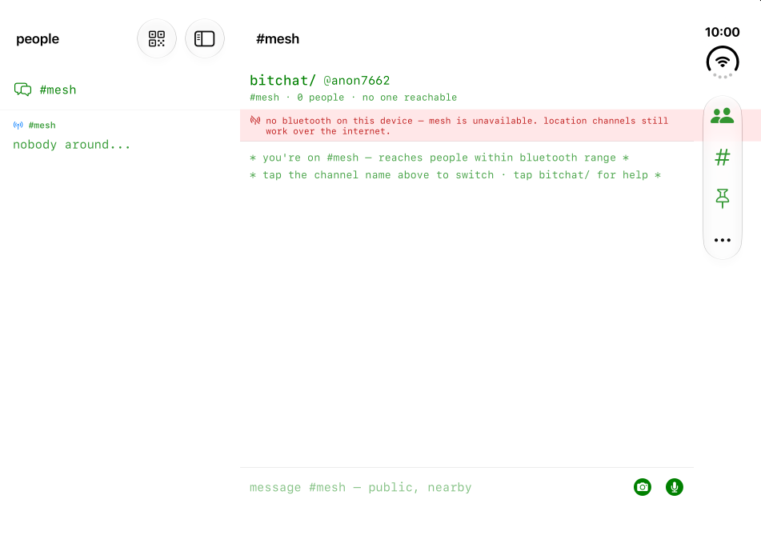

# iPhone Duo



Build with Xcode 27.1 or later and the iOS 27.1 SDK for the full-display layout and system vertical bars. The deployment target remains iOS 16. New toolbar APIs have both SDK and runtime availability gates.

## Navigation and state

On iOS 17 and later, one `NavigationSplitView` owns the people sidebar and the active public or private conversation. The system expands, collapses, and positions its columns as the available space changes. The detail keeps one `NavigationStack`; folding does not replace the navigation tree based on a device model, orientation, or screen dimensions.

Conversation selection, the shared composer, draft keys, recording state, and message-window counts remain above the split view. Opening the sidebar preserves the selected private chat. The public-channel row explicitly returns to public chat. Selecting an already-open private chat returns to its detail as well.

Split navigation has one root owner for Bluetooth and recording alerts. It defers to verification, media, and private-media consent presentations. iOS 16 and macOS retain the existing people-sheet flow and its local alert owner.

## Adaptive controls

- iOS chat actions use labeled system toolbar items and system overflow on iOS 27.1. The identity editor, channel/connectivity summary, and private transport/encryption status remain readable in content when bars move to the side.
- The full-screen requirement is removed, and all four orientations are declared. This enables outer-display landscape as well as resizable inner-display windows.
- Verification, fingerprints, and channel selection scroll in short windows. QR codes fit the available width. Media and globe actions use system toolbars; interactive surfaces respect safe areas.
- The QR scanner preserves the full preview image. iOS 17 and later use the capture-device rotation coordinator; iOS 16 uses the preview's own scene for camera orientation.
- A microphone hold starts once. Gesture cancellation, resizing, disappearing content, and an inactive scene cancel active capture, including a pending permission request. Released voice-note finalization retains its existing behavior.

No Duo dimensions, hinge angle, camera rectangle, or fold width are hard-coded. Standard split views and sheets own fold avoidance. An arrangement is not nested inside the split view.

## Reproducing validation

Use a dedicated iPhone Duo simulator in Device Hub. Keep local builds bounded, for example:

```sh
xcodebuild -project bitchat.xcodeproj -scheme 'bitchat (iOS)' \
  -destination 'platform=iOS Simulator,id=<simulator UUID>' \
  -derivedDataPath .DerivedData -jobs 2 -parallel-testing-enabled NO \
  -only-testing:bitchatTests_iOS/ViewSmokeTests \
  -only-testing:bitchatTests_iOS/ComposerDraftStoreTests \
  -only-testing:bitchatTests_iOS/ChatPrivateConversationCoordinatorContextTests \
  -only-testing:bitchatTests_iOS/VoiceCaptureSessionTests \
  CODE_SIGNING_ALLOWED=NO test
```

`contentWorkspace_preservesConversationAndDraftAcrossResizing` mounts one workspace in a live window scene, enters distinct public/private drafts, changes compact/regular traits and container proportions, and verifies selection, draft preservation, and restoration after switching conversations. Its container sizes are representative test proposals, not hardware specifications.

The Duo lint audit has no confirmed iOS layout findings. Remaining fixed-width reports are enclosed in macOS-only branches. The iOS 16 camera-orientation fallback is for rendering camera imagery, not choosing a layout.

## Device acceptance matrix

Repeat with matrix and glass themes, light/dark appearance, accessibility text sizes, and right-to-left text:

1. Closed portrait and landscape: open people, return to the same chat, edit a draft, show/dismiss keyboard, and use every toolbar action.
2. Open and partially open, rotated both ways: verify columns, side controls, composer, transcript scrolling, and transport/encryption status. Fold/unfold while a DM and an unsent draft are open.
3. Present channel selection, globe, notices, app information/settings, fingerprints, verification, photo picker, and image preview before changing displays. Check scrolling and dismissal after resizing.
4. In Split View, test both sides at narrow and wide allocations, including a pinned Picture in Picture window. Preserve chat and draft while resizing.
5. On hardware, rotate the QR camera, verify a peer, send/receive photos and voice notes, and interrupt a held mic by folding, changing apps, and presenting a permission prompt.
6. Resize iPhone Mirroring on macOS 27 to extreme widths and heights.

Local verification used Xcode 27.1 RC (27A9275) and an iOS 27.1 Duo simulator. Native inner-display split navigation, side bars, and the verification sheet were inspected. An intermediate run passed 52 tests (view smoke tests including selection/draft resizing, draft persistence, and private conversation coordination). The final iOS app/test bundle and macOS app compile, and SwiftLint exits successfully with two existing image aspect-ratio warnings. After the camera/microphone follow-up, simulator test reruns stall before execution while Xcode reports `IDESchemeActionSDKRecord` / `IDESchemeActionDeviceRecord` parsing `24A94232` as `invalidDigitCount(94232)`, including after a dedicated simulator reboot. Those final tests, including the new microphone HUD/resize regression, are not claimed as passing. Hinge commands dispatched but their automatic confirmation failed because the installed CoreDevice tool rejected the automation's `hinge-angle --device` argument. Consequently, exact hinge-angle confirmation and the complete pose/Split View/PiP/Mirroring matrix remain manual acceptance work. Real Bluetooth exchange, camera rotation, and interrupted physical touches require hardware; simulator builds and layout tests do not establish those results.

App Store screenshots and the optimized-for-iPhone-Duo badge are release work, separate from this code change.

## Apple guidance

- [Three steps to make your app shine on iPhone Duo](https://developer.apple.com/iphone-duo/prepare/)
- [Designing for iPhone Duo](https://developer.apple.com/design/human-interface-guidelines/designing-for-iphone-duo)
- [Raise the bar with iPhone Duo](https://developer.apple.com/videos/play/tech-talks/111462/)
- [Strike a pose with adaptive layouts on iPhone Duo](https://developer.apple.com/videos/play/tech-talks/111463/)
- [Camera preview rotation](https://developer.apple.com/documentation/avfoundation/avcapturedevice/rotationcoordinator/videorotationangleforhorizonlevelpreview)

The audit also used Apple's exported App Resizability skill. Exported skill files and build artifacts are local verification inputs and are not app dependencies.
